<div align="center">

# Claw Control

**Fast, controller-first quick settings for the MSI Claw A8.**
One press of the MSI Center M button and a glass panel slides over your game, ready to drive with the D-pad.

[](https://github.com/mustafameh/claw-control/releases/latest)


[](LICENSE)


</div>

> [!IMPORTANT]
> **Made only for the MSI Claw A8.** Claw Control was built and tested on one MSI Claw A8
> (board MS-1T8K). I don't own the other Claw models (Claw A1M, Claw 7 AI+, Claw 8 AI+), so it
> has **not** been tested on them, and they use different firmware and controller details. The
> setup and the app both check the device and refuse to run anywhere else, before changing
> anything.

## Why

MSI Center M's quick settings are slow to open and awkward with a controller. Claw Control
replaces them with a panel that opens instantly (it's pre-rendered and waiting), is fully driven
by the controller (or touch), never lets the controller reach the game behind it, and uses
almost nothing while it's closed.

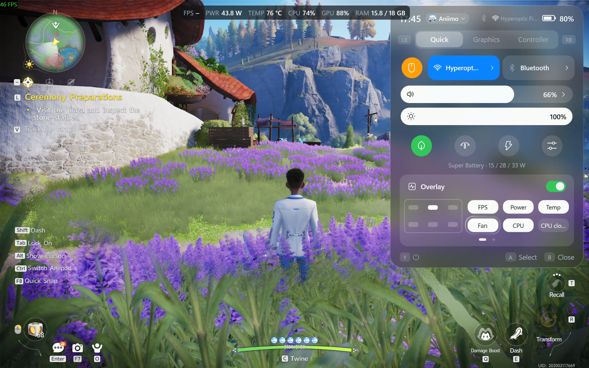

## Features

| | | |
|:---:|:---:|:---:|
| 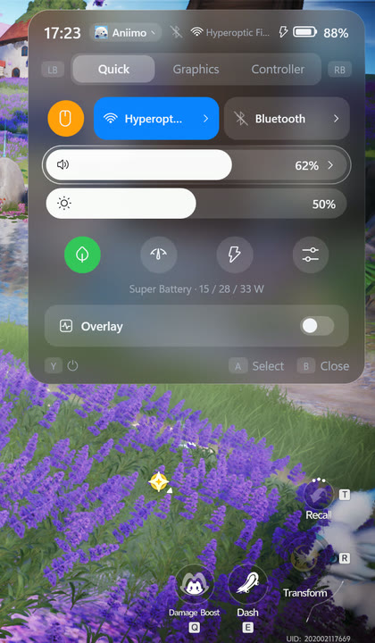<br>**Quick tab**<br>Volume, brightness, Wi-Fi, Bluetooth, controller mode, now playing | 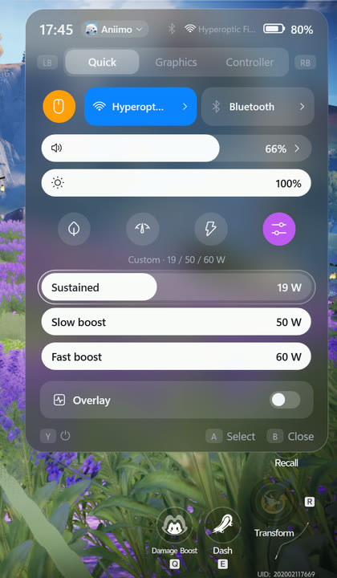<br>**Power modes**<br>Super Battery, Balanced, Performance, or your own watts | 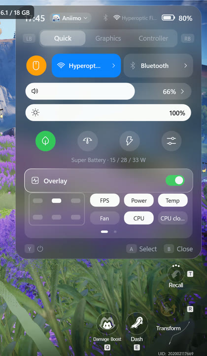<br>**Performance overlay**<br>FPS, power, temps, CPU, GPU, RAM… in any corner |
| 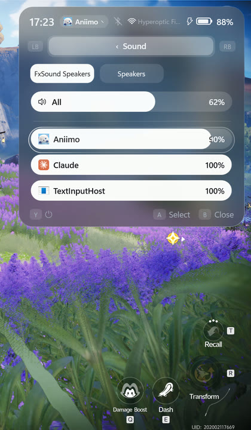<br>**Sound**<br>Output device and per-app volume | 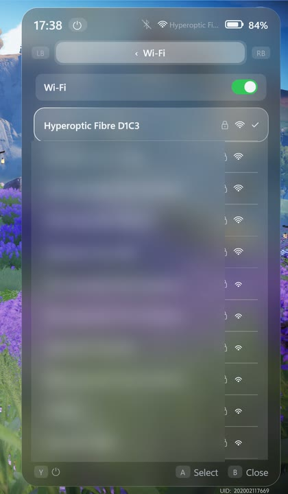<br>**Wi-Fi and Bluetooth**<br>Switch them, connect networks and headphones | 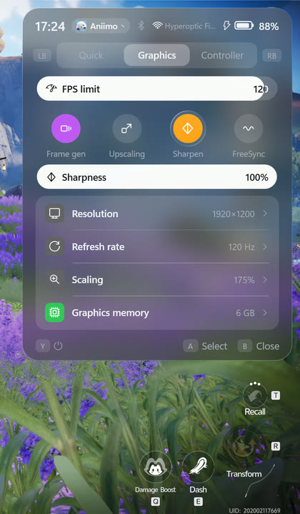<br>**Graphics tab**<br>FPS limit, frame gen, upscaling, sharpening, FreeSync |
| 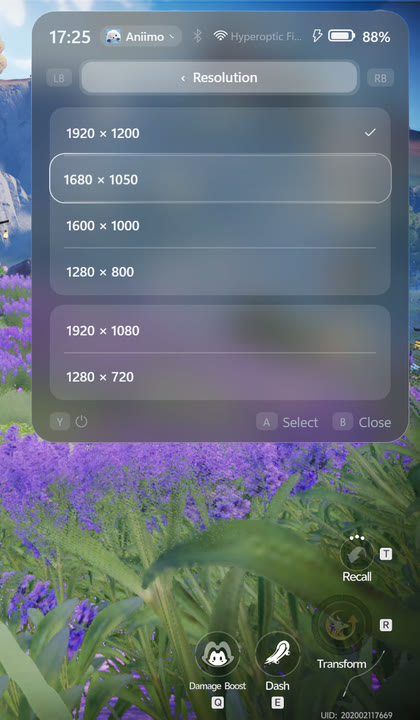<br>**Display**<br>Resolution, refresh rate, Windows scaling, graphics memory | 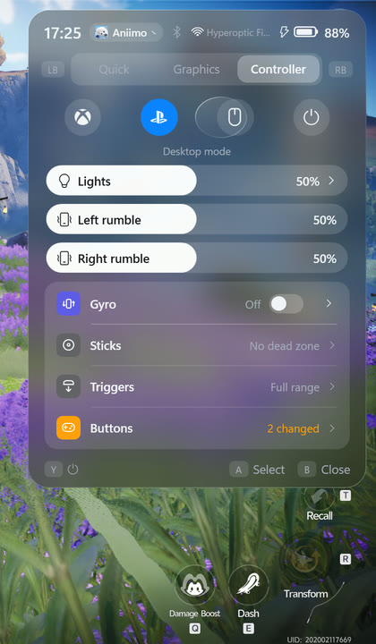<br>**Controller tab**<br>Xbox, PlayStation, mouse or off; lights, rumble, gyro | 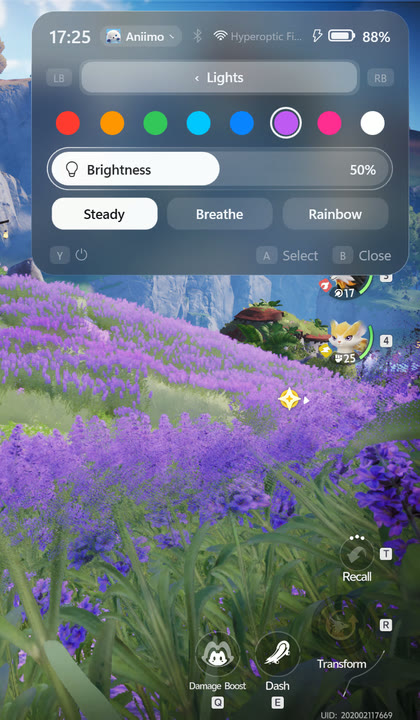<br>**Lights**<br>Colours, effects, speed, brightness |
| 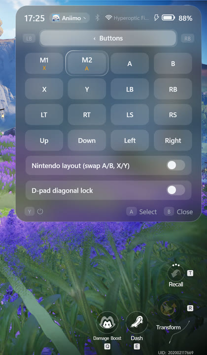<br>**Buttons**<br>Remap any button, turbo, Nintendo layout | 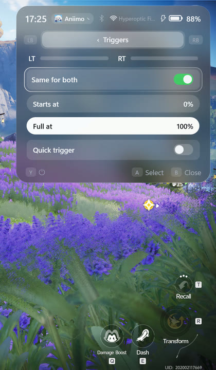<br>**Triggers and sticks**<br>Ranges, quick trigger, dead zones, live view | 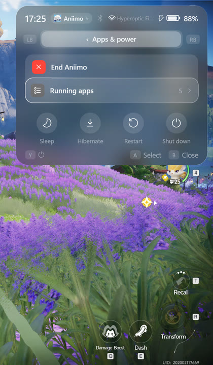<br>**Apps & power**<br>End a frozen game, running apps, sleep, restart |

- **Instant:** the panel is built once at startup and only shown and hidden.
- **Controller-first:** D-pad / left stick to move, **A** select, **B** back, **LB / RB** tabs,
  **Y** Apps & power. Touch works everywhere too.
- **Never leaks input:** while the panel is open the controller drives only the panel, in Xbox
  and in MSI's Desktop (mouse) mode.
- **Same size everywhere:** the panel keeps its size and stays pinned to the right at any
  resolution or Windows scaling.
- **Light on battery:** with the panel closed it uses about 0.3 % of one CPU core and polls
  nothing. No internet connection, no telemetry.

## Download and install

1. Download **`ClawControl-Setup-<version>.exe`** from the
   [latest release](https://github.com/mustafameh/claw-control/releases/latest).
2. Run it. Windows may say *"Windows protected your PC"* because the setup isn't code-signed:
   click **More info › Run anyway**.
3. Allow the admin prompt and click through the setup. It checks for an MSI Claw A8, MSI Center
   M and the AMD graphics driver first, and tells you if anything is missing.
4. Press the **MSI Center M button**. That's it.

Prefer no installer? Use the **`.zip`** from the same release and double-click `Install.cmd`.

**You need:** an MSI Claw A8 with Windows 11, MSI Center M and the AMD graphics driver (all
preinstalled on the Claw). Nothing else: the app brings its own .NET runtime.

Full guide, including what gets installed and how to check the download:
[docs/INSTALL.md](docs/INSTALL.md).

## How to use

| Do this | Xbox buttons | PlayStation names |
|---|---|---|
| Open / close the panel | MSI Center M button | MSI Center M button |
| Move | D-pad or left stick | D-pad or left stick |
| Select, switch on / off | A | ✕ Cross |
| Back / close | B | ○ Circle |
| Previous / next tab | LB / RB | L1 / R1 |
| Apps & power | Y | △ Triangle |
| Change a bar | D-pad left / right on it | D-pad left / right on it |

Everything applies immediately; there's no Save button. The new controller mode applies when you
close the panel, and graphics memory after a restart. The full tour of every tab and screen is
in the [user guide](docs/USER-GUIDE.md).

## What it changes on your system

- Installs to `C:\Program Files\ClawControl` and adds a scheduled task that starts it at sign-in
  with admin rights (needed for power limits and the controller) and restarts it after a crash.
- Takes over the MSI Center M button by pausing MSI's launcher while it runs. Quitting or
  uninstalling hands the button straight back. Nothing of MSI's is changed or removed.
- Writes your changes where MSI Center M would: firmware power limits, the controller's own
  memory, AMD driver settings, display and sound settings.

**Uninstall:** Settings › Apps › Installed apps › Claw Control › Uninstall. The MSI button goes
back to MSI Center M; the settings you applied to the device stay as they are.

## Help

- [Troubleshooting and FAQ](docs/TROUBLESHOOTING.md): the panel doesn't open, graphics settings
  only apply after a game restart, upscaling is missing, and more.
- Found a bug? [Open an issue](https://github.com/mustafameh/claw-control/issues/new/choose) and
  attach `%LOCALAPPDATA%\ClawControl\log.txt`.
- Security problem? See [SECURITY.md](SECURITY.md).

## Building from source

Needs the .NET 10 SDK on Windows:

```powershell
dotnet build ClawControl.csproj -c Release
installer\install.ps1 -Source bin\Release\net10.0-windows10.0.19041.0\win-x64 -Yes
```

`build-release.ps1` builds the setup and zip (needs Inno Setup 6). How it's put together:
[docs/DEVELOPMENT.md](docs/DEVELOPMENT.md); how the hardware is driven:
[docs/HARDWARE.md](docs/HARDWARE.md). Contributions welcome: [CONTRIBUTING.md](CONTRIBUTING.md).
Own another Claw model and want to help support it? Start there.

## License and credits

[MIT](LICENSE). Uses Intel PresentMon (FPS), NAudio, HidSharp and .NET; see
[THIRD-PARTY-NOTICES.md](THIRD-PARTY-NOTICES.md).

Claw Control is an independent project, not made by or affiliated with MSI, AMD, Microsoft or
Sony. MSI, Claw and MSI Center M are trademarks of Micro-Star International; Xbox of Microsoft;
PlayStation of Sony Interactive Entertainment; AMD, Radeon and FreeSync of AMD. It comes with no
warranty: use it at your own risk.
